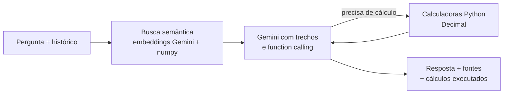

# TaxBot — O Agente do Imposto de Renda

**Agente de IA que explica e calcula a nova tributação da renda no Brasil (Lei 15.270/2025).**

🏆 Projeto vencedor da disciplina Projetos III da FGV EESP (dez/2025)
🚀 **Versão no ar:** [huggingface.co/spaces/DCezaum/TaxBot_Alpha](https://huggingface.co/spaces/DCezaum/TaxBot_Alpha)

---

## O problema

A Lei 15.270/2025 (originada do PL 1.087/2025) muda a tributação da renda a partir de 2026: isenção efetiva
até R$ 5 mil por mês, redução decrescente até R$ 7.350, retenção de 10% sobre dividendos acima de R$ 50 mil
mensais por empresa e uma tributação mínima para altas rendas (IRPFM). As regras estão espalhadas em lei,
notas técnicas e estudos, e o contribuinte comum não consegue saber como elas o afetam.

## Como o agente funciona



**Ferramentas de cálculo** (`calculadoras.py`), testadas em `tests/`:

| Ferramenta | O que calcula |
|---|---|
| `calcular_irrf_mensal` | IRRF do mês: tabela progressiva + redução do art. 3º-A, com deduções ou desconto simplificado |
| `calcular_ir_ajuste_anual` | Ajuste anual com a redução do art. 11-A: imposto devido × retido → pagar ou restituir |
| `calcular_retencao_dividendos_mensal` | Retenção de 10% por empresa que paga mais de R$ 50 mil no mês (art. 6º-A) |
| `calcular_irpfm_anual` | Tributação mínima (0% a 10%), abatimentos e redutor PJ + IRPFM > 34% (arts. 16-A e 16-B) |

O Gemini pode chamar várias ferramentas em sequência na mesma pergunta, e as últimas 5 trocas da conversa
são enviadas como memória.

## Stack

Python · Google Gemini (`gemini-flash-lite-latest`, com `gemini-flash-latest` de reserva, + `gemini-embedding-001`, plano gratuito) · numpy · Streamlit ·
Streamlit Community Cloud

## Estrutura

```
taxbot-alpha/
├── app.py              # interface de chat (Streamlit)
├── agente.py           # busca nos documentos + Gemini com function calling
├── calculadoras.py     # regras da Lei 15.270/2025 em Decimal
├── ingest.py           # gera o índice vetorial a partir dos PDFs
├── indice/             # trechos.json + vetores.npy (gerados pelo ingest.py)
├── tests/              # casos de referência das calculadoras
└── requirements.txt
```

## Como rodar localmente

1. Crie uma chave gratuita em [aistudio.google.com/apikey](https://aistudio.google.com/apikey) e copie
   `.env.example` para `.env` com a chave.
2. Instale e gere o índice (lê `../Memória TaxBot Alpha` e `./documentos`, se existir):

```bash
pip install -r requirements.txt
python ingest.py
streamlit run app.py
```

Testes: `pip install pytest && pytest`.

## Deploy no Hugging Face Spaces

1. Faça login uma vez: `python -c "from huggingface_hub import login; login()"` (token com permissão *Write*,
   criado em [huggingface.co/settings/tokens](https://huggingface.co/settings/tokens)).
2. No Space, em *Settings → Variables and secrets*, crie o secret `GEMINI_API_KEY`.
3. Rode `python deploy_hf.py`. O script envia o app e o índice e apaga os arquivos da versão antiga.

## Deploy no Streamlit Community Cloud

1. Faça commit da pasta `indice/` e envie ao GitHub.
2. Em [share.streamlit.io](https://share.streamlit.io), **Create app** → repositório `DCezaum/taxbot-alpha`,
   arquivo `app.py`, Python 3.12 em *Advanced settings*.
3. Em *Secrets*, cole `GEMINI_API_KEY = "sua-chave"`.

## Limitações conhecidas e próximos passos

- A tabela anual de 2026 foi considerada como 12 × a mensal; confirmar com a tabela oficial da Receita.
- O redutor do IRPFM usa uma alíquota efetiva única da PJ; a lei calcula por empresa pagadora.
- O plano gratuito do Gemini tem limite diário de requisições e pode usar os dados para treinar modelos.
- Avaliação: criar um conjunto de perguntas com respostas de referência para medir a precisão das respostas.

> ⚠️ O TaxBot fornece informação geral e **não** constitui aconselhamento tributário, contábil ou jurídico.

---
Autor: Cezar Cherfen Ragonha · [LinkedIn](https://www.linkedin.com/in/cezar-cherfen-ragonha-33797b246/) · [GitHub](https://github.com/DCezaum)
