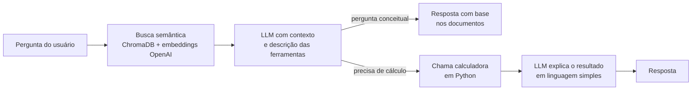

# TaxBot — O Agente do Imposto de Renda

**Agente de IA que explica e calcula a nova tributação da renda no Brasil (PL 1.087/2025).**

🏆 Projeto vencedor da disciplina Projetos III da FGV EESP (dez/2025)
🚀 **Versão no ar:** [huggingface.co/spaces/DCezaum/TaxBot_Alpha](https://huggingface.co/spaces/DCezaum/TaxBot_Alpha)

---

## O problema

O PL 1.087/2025 muda a forma como a renda é tributada: isenção até R$ 5 mil por mês, faixa de transição até
R$ 7.350, retenção de 10% sobre dividendos acima de R$ 50 mil mensais e um imposto mínimo para altas rendas
(IRPFM). As regras estão espalhadas em projeto de lei, notas técnicas e estudos, e o contribuinte comum não
consegue saber como elas o afetam.

## Como o agente funciona

O TaxBot combina duas capacidades: **busca em documentos (RAG)** para perguntas conceituais e
**uso de ferramentas** para perguntas que envolvem cálculo.



**Base de conhecimento:** 320 trechos indexados de 14 documentos, entre eles o texto do PL 1.087/2025, o estudo
do Ministério da Fazenda (SPF/SPE) sobre o projeto, análise do FGV IBRE, nota técnica sobre progressividade
tributária e materiais de perguntas e respostas.

**Ferramentas de cálculo** (`pergunte_2.py`), todas com aritmética `Decimal` para evitar erros de arredondamento:

| Ferramenta | O que calcula |
|---|---|
| `irrf_mensal_sem_deducoes` | IR retido na fonte sobre o salário mensal, incluindo a faixa de transição |
| `calc_ir_trabalho_anual` | Ajuste anual: imposto devido × imposto retido → saldo a pagar ou a restituir |
| `calc_irpfm_dividendos_mensal` | Retenção de 10% sobre dividendos acima de R$ 50 mil no mês |
| `calc_irpfm_anual` | Imposto mínimo anual sobre altas rendas (alíquota progressiva de 0% a 10%) |

## Stack

Python · LangChain · OpenAI (`gpt-5-mini` e `text-embedding-3-small`) · ChromaDB · Streamlit · Hugging Face Spaces

## Estrutura

```
taxbot-alpha/
├── app.py            # interface de chat (Streamlit)
├── pergunte_2.py     # recuperação, prompt, ferramentas de cálculo e laço de execução do agente
├── requirements.txt
└── runtime.txt
```

A base vetorial (`chroma_taxbot/`, ~63 MB) não está neste repositório. Ela pode ser baixada da
[aba Files do Space](https://huggingface.co/spaces/DCezaum/TaxBot_Alpha/tree/main).

## Como rodar localmente

```bash
pip install -r requirements.txt streamlit
# copie a pasta chroma_taxbot/ do Space para a raiz do projeto
export OPENAI_API_KEY="sua-chave"   # ou crie um arquivo .env
streamlit run app.py
```

## Limitações conhecidas e próximos passos

Esta é a versão **Alpha**. Pontos que já mapeei para a próxima versão:

- **Uma ferramenta por pergunta:** a chamada de ferramenta é extraída do texto da resposta.
  Próximo passo: migrar para o *function calling* nativo da API, permitindo várias chamadas encadeadas.
- **Memória da conversa:** o histórico aparece na tela, mas ainda não é enviado ao modelo.
- **Cálculo simplificado** acima de R$ 7.350: aplicar a tabela progressiva completa com parcela a deduzir.
- **Filtros de busca:** os seletores de tipo de conteúdo e nível de detalhe ainda não alteram a resposta.
- **Avaliação:** criar um conjunto de perguntas com respostas de referência para medir a precisão do agente.

> ⚠️ O TaxBot fornece informação geral e **não** constitui aconselhamento tributário, contábil ou jurídico.

---
Autor: Cezar Cherfen Ragonha · [LinkedIn](https://www.linkedin.com/in/cezar-cherfen-ragonha-33797b246/) · [GitHub](https://github.com/DCezaum)
